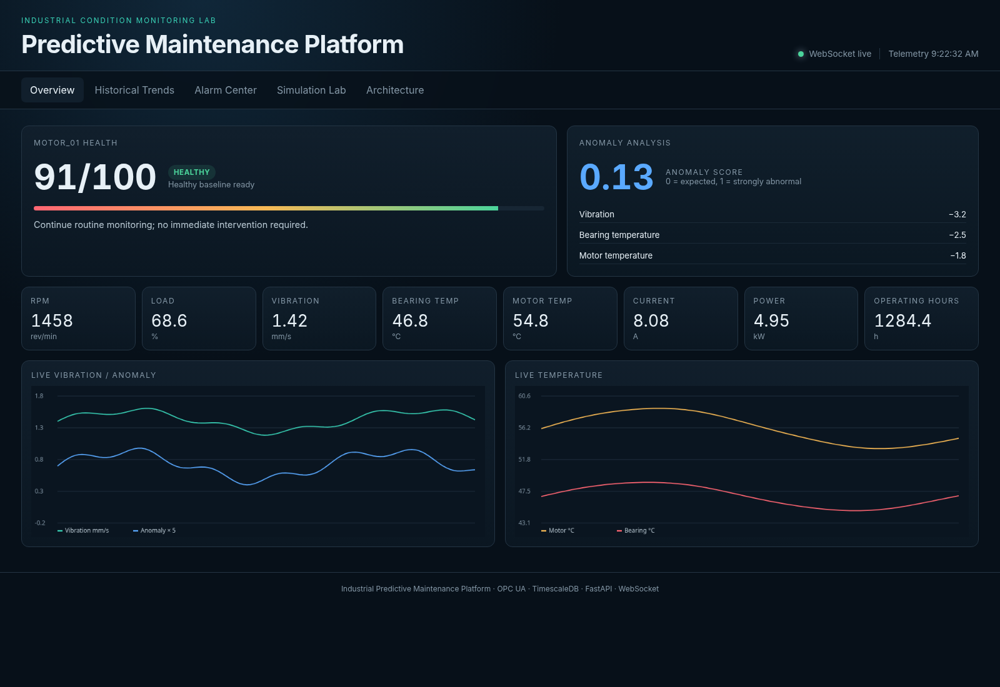

# Industrial Predictive Maintenance Platform

An end-to-end **OPC UA condition-monitoring and predictive-maintenance lab**
built around a simulated industrial motor. The project demonstrates
subscription-based telemetry collection, a TimescaleDB historian, explainable
anomaly detection, health scoring, persistent alarm lifecycle management,
FastAPI REST/WebSocket services and a live browser dashboard.

<p align="center">
  
  
  
  
  
  
</p>



<p align="center"><em>Dashboard preview rendered from the project UI with synthetic demonstration telemetry.</em></p>

> **Scope:** educational and demonstration software. It is not a certified
> machine-protection system, it does not control real machinery, and it does
> not claim Remaining Useful Life (RUL) prediction.

## Technology stack

| Layer | Technology | Responsibility |
| --- | --- | --- |
| Machine simulation | Python motor digital twin | Coupled operating behavior and gradual fault progression |
| Industrial communication | OPC UA with `asyncua` | Structured NodeIds, reads/writes, subscriptions and Monitored Items |
| Data acquisition | Async Python collector | Converts OPC UA changes into coherent analyzed telemetry snapshots |
| Historian | PostgreSQL + TimescaleDB | Time-series telemetry, baselines and persistent alarm lifecycle state |
| Analytics | Python statistical models | Load-compensated anomaly detection, health scoring and alarm rules |
| Backend | FastAPI | REST endpoints, OpenAPI documentation and simulator control |
| Live transport | WebSocket | Pushes telemetry and alarm updates to the browser |
| Frontend | HTML, CSS, JavaScript, Canvas | Live maintenance dashboard and trend visualization |
| Runtime | Docker + Docker Compose | Reproducible multi-service local deployment |

## Architecture

```text
┌──────────────────────────────┐
│ Motor Digital Twin           │
│ physics + gradual faults     │
└──────────────┬───────────────┘
               │ OPC UA :4840
               ▼
┌──────────────────────────────┐
│ Subscription Collector       │
│ Monitored Items              │
│ 250 ms sample / 500 ms pub   │
└──────────────┬───────────────┘
               │ 1 s coherent snapshot
               ▼
┌──────────────────────────────┐
│ Analytics Pipeline           │
│ anomaly + health + alarms    │
└──────────────┬───────────────┘
               │ SQL
               ▼
┌──────────────────────────────┐
│ TimescaleDB / PostgreSQL     │
│ historian + alarm lifecycle  │
└──────────────┬───────────────┘
               │
        ┌──────┴─────────┐
        ▼                ▼
   FastAPI REST      WebSocket
        └──────┬─────────┘
               ▼
      Maintenance Dashboard

Dashboard simulation commands ──OPC UA Write──> Motor controls
```

## Highlights

- Coupled motor digital twin: RPM, load, voltage, current, power, vibration,
  motor/bearing/ambient temperatures, run state and operating hours.
- Gradual fault scenarios: bearing wear, misalignment, overload and cooling failure.
- Structured OPC UA information model with stable string NodeIds.
- Writable OPC UA simulation controls.
- OPC UA Subscription + Monitored Items instead of repeated client polling.
- TimescaleDB telemetry hypertable used as an industrial-style historian.
- Persisted healthy baseline across collector restarts.
- Load-compensated residual anomaly detector.
- Explainable 0–100 health score with contributors and maintenance recommendation.
- Persistent alarm lifecycle: `ACTIVE -> ACKNOWLEDGED -> CLEARED`.
- FastAPI REST API, OpenAPI docs and WebSocket live updates.
- Browser-native charts with no chart CDN dependency.
- Docker Compose, health checks, unit tests and runtime smoke checks.

## Public-repository safety

This repository is designed to be publishable without private environment data:

- it contains only synthetic motor telemetry;
- it requires no real broker, cloud or plant credentials;
- no personal name, email, organization address or user filesystem path is required;
- `.env` is excluded from both Git and Docker build context;
- the database password has no committed default;
- the Docker image copies only runtime source directories;
- host ports bind to `127.0.0.1` by default.

See [`SECURITY.md`](SECURITY.md) and [`docs/security.md`](docs/security.md).

## Quick start

### Requirements

- Docker Desktop or Docker Engine with Docker Compose
- Python 3.10+ only for helper scripts/tests

Create a private local `.env` with a generated database password:

```powershell
python scripts/init_env.py
```

Then start the stack:

```powershell
docker compose up --build
```

Open:

- Dashboard: `http://localhost:8000`
- API docs: `http://localhost:8000/docs`
- OPC UA from host: `opc.tcp://127.0.0.1:4840/predictive-maintenance/server/`
- TimescaleDB from host: `127.0.0.1:5433`

To configure values manually instead:

```powershell
Copy-Item .env.example .env
```

Then set `POSTGRES_PASSWORD` in `.env` before starting Compose.

## Demo flow

1. Start the stack and open the dashboard.
2. Allow about 30 seconds for the healthy anomaly baseline to become ready.
3. Open **Simulation Lab** and inject `BEARING_WEAR` at 100%.
4. Observe the gradual rise in vibration and bearing temperature.
5. Watch anomaly score rise and health score move toward `WARNING`/`CRITICAL`.
6. Open **Alarm Center** and acknowledge an active alarm.
7. Reset the fault and observe physical variables recover gradually.
8. Open **Historical Trends** to inspect the event stored in TimescaleDB.

## OPC UA information model

```text
Objects
└── Factory
    └── Motor_01
        ├── Electrical
        │   ├── Voltage
        │   ├── Current
        │   └── Power
        ├── Mechanical
        │   ├── RPM
        │   ├── Load
        │   └── Vibration
        ├── Thermal
        │   ├── MotorTemperature
        │   ├── BearingTemperature
        │   └── AmbientTemperature
        ├── Status
        │   ├── Running
        │   ├── OperatingHours
        │   ├── FaultMode
        │   └── FaultProgress
        └── Controls
            ├── FaultMode
            ├── FaultIntensity
            ├── TargetLoad
            ├── RunningCommand
            └── ResetFault
```

The client discovers the namespace index at runtime from
`urn:factory:predictive-maintenance`; it does not assume a fixed `ns=2`.

## Repository layout

```text
industrial-predictive-maintenance/
├── .github/                   CI, Dependabot and issue templates
├── analytics/                 anomaly, health and alarm rules
├── backend/                   FastAPI, WebSocket and OPC UA control
├── collector/                 OPC UA subscription collector
├── common/                    settings, data models, DB and NodeIds
├── dashboard/                 HTML/CSS/JavaScript UI
├── database/                  TimescaleDB initialization
├── docs/                      architecture and engineering notes
├── scripts/                   setup, audit and smoke-check helpers
├── simulator/                 motor model and OPC UA server
├── tests/                     unit tests
├── compose.yaml
├── Dockerfile
└── requirements.txt
```

## Testing

Install development requirements:

```powershell
python -m pip install -r requirements-dev.txt
```

Run the unit suite:

```powershell
python -m pytest
```

Run the repository privacy/secret sanity check:

```powershell
python scripts/repository_audit.py
```

With the Docker stack running:

```powershell
python scripts/smoke_check.py
```

## Operations

```powershell
# All logs
docker compose logs -f

# Collector only
docker compose logs -f collector

# Rebuild after source changes
docker compose up --build

# Stop while keeping historian data
docker compose down

# Delete historian, alarms and learned baseline
docker compose down -v
```

## Engineering documentation

- `docs/project-plan.md` — requirements, contracts, tests and exclusions
- `docs/architecture.md` — service boundaries and design decisions
- `docs/opcua-model.md` — Node tree, NodeIds and subscription behavior
- `docs/analytics.md` — anomaly, health score and alarm methodology
- `docs/database-schema.md` — historian/alarm/state tables
- `docs/api.md` — REST and WebSocket endpoints
- `docs/operations.md` — runbook and troubleshooting
- `docs/security.md` — local lab security model vs production requirements
- `docs/validation.md` — validation notes

## CI and dependency maintenance

GitHub Actions runs source compilation, the repository safety audit, unit tests,
Compose validation and a Docker image build. Dependabot is configured for Python,
Docker and GitHub Actions dependencies.

For a public repository, also review GitHub's repository security settings and
keep secret scanning, push protection, dependency alerts and code scanning
enabled where available.

## License

MIT. See [`LICENSE`](LICENSE).
